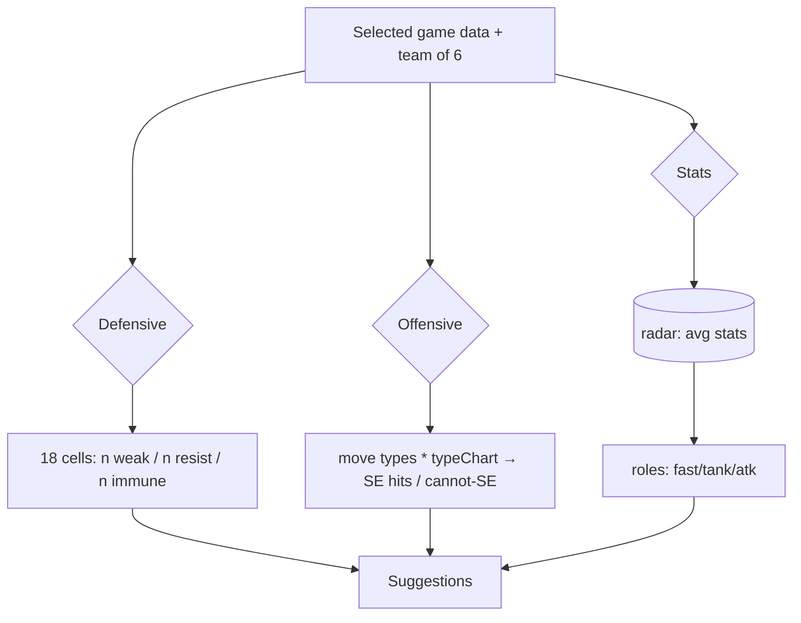

# Dexforge — Architecture

Last updated: 2026-11-05 · state: v0.1.0 scaffold + data pipeline

> ⚠ Numbering: the version of the code this document describes is noted above.
> Update this file whenever folder structure, schemas or data flow change.

## Tech stack

| Layer           | Choice                                                 |
| --------------- | ------------------------------------------------------ |
| Framework       | Astro 5 (static output) + React 19 islands             |
| Language        | TypeScript, `strict`                                   |
| Styling         | Tailwind CSS v4 (via `@tailwindcss/vite`)              |
| State (islands) | Zustand (from v0.2)                                    |
| Charts          | Hand-rolled lightweight SVG radar (no chart lib)       |
| Data            | Static JSON in `/public/data`, generated by `/scripts` |
| Tests           | Vitest (unit) · Playwright (key flows, from v0.2)      |
| Lint/format     | ESLint (flat) + Prettier                               |
| CI              | GitHub Actions                                         |
| Deploy          | Cloudflare Pages / Vercel (owner connects account)     |
| Package manager | pnpm                                                   |

## Folder structure

```
dexforge/
├── public/
│   ├── data/                 # GENERATED static JSON — the app's only data source
│   │   ├── games.json        # registry of supported games
│   │   ├── types.json        # 18 types, names EN/ES, colors
│   │   └── <game-id>.json    # full dataset per game (dex, type chart, encounters…)
│   └── favicon.svg
├── data/                     # hand-curated data (source of truth for curation)
│   ├── SCHEMA.md             # curated data rules
│   └── curated/<game-id>.json
├── scripts/
│   ├── .cache/               # gitignored raw PokeAPI mirror (pokeapi/<endpoint>/<id>.json)
│   ├── lib/
│   │   ├── http.ts           # cache-first fetcher, retries, politeness (rate limit)
│   │   ├── schema.ts         # TS types shared with src/lib (output JSON schemas)
│   │   └── games.ts          # game definitions (id → version-group → generation → dex)
│   ├── build.ts              # pipeline orchestrator
│   └── validate.ts           # post-build sanity checks
├── src/
│   ├── layouts/Base.astro
│   ├── lib/
│   │   ├── data-schema.ts    # re-export of scripts/lib/schema.ts types (app side)
│   │   ├── i18n.ts           # ES (default) / EN dictionaries
│   │   └── pokemon/          # (v0.3+) team analysis engine, pure functions
│   ├── pages/index.astro
│   └── styles/global.css
├── tests/                    # Vitest unit tests (type chart, analysis, pipeline)
├── docs/                     # project documentation system
└── .github/                  # CI workflows, issue/PR templates
```

## Data flow

```mermaid
flowchart LR
  subgraph Run "pnpm run data (manual/CI-on-demand)"
    P[scripts/build.ts] -- cache-first GET --> A[PokeAPI.co]
    A -. raw JSON .-> C[(scripts/.cache)]
    C -- process --> P
    G[(data/curated/*.json)] --> P
    P -- emits --> O[(public/data/*.json)]
  end
  subgraph Site "astro build + runtime"
    O -- fs read / island fetch --> U[React islands]
    U -- pure TS --> E[Team analysis engine]
  end
```

**Rule:** the deployed site NEVER calls PokeAPI at runtime. Runtime HTTP is limited to:

- `https://raw.githubusercontent.com/PokeAPI/sprites/...` (sprite images, static CDN)

## Per-game JSON schema (v1)

`public/data/games.json`

```jsonc
{
  "generatedAt": "ISO-8601",
  "games": [
    {
      "id": "red-blue", // stable slug, used in URLs & file names
      "label": { "en": "Red/Blue", "es": "Rojo/Azul" },
      "region": "kanto",
      "generation": 1,
      "generationSlug": "generation-i",
      "versionGroup": "red-blue", // PokeAPI version-group slug
      "versions": ["red", "blue"], // members of the group
      "spriteVersionGroup": "red-blue", // key in sprites.versions.<gen>.<vg>
      "pokedexes": ["kanto"],
      "pokemonCount": 151,
    },
  ],
}
```

`public/data/types.json`

```jsonc
{
  "generatedAt": "ISO-8601",
  "types": [
    {
      "id": 1,
      "slug": "normal",
      "name": { "en": "Normal", "es": "Normal" },
      "color": "#A8A87B", // app-side palette
    },
  ],
}
```

`public/data/<game-id>.json`

```jsonc
{
  "meta": {
    "id": "red-blue",
    "label": { "en": "Red/Blue", "es": "Rojo/Azul" },
    "generation": 1,
    "versionGroup": "red-blue",
    "versions": ["red", "blue"],
    "region": "kanto",
    "pokedexes": [{ "id": 1, "slug": "kanto", "name": { "en": "Kanto", "es": "Kanto" } }],
    "generatedAt": "ISO-8601"
  },
  "typeChart": {
    // attacker -> defender -> effectiveness, GAME-ACCURATE (from past_damage_relations)
    "normal":   { "rock": 0.5, "ghost": 0 },
    "electric": { "water": 2, "grass": 0.5 }
  },
  "moves": {
    // national move id (as string) -> details; pruned to moves learnable in this game
    "53": {
      "slug": "flamethrower",
      "name": { "en": "Flamethrower", "es": "Lanzallamas" },
      "type": "fire",                  // game-accurate (past_values applied per field)
      "damageClass": "special",        // in Gen 1-3 derived from the type, not per move
      "power": 95,                     // Gen 1-5 value, 90 from X/Y on
      "accuracy": 100,
      "pp": 15,
      "generation": 1
    }
  },
  "abilities": {
    // ability slug -> details; pruned to abilities used by this game's species
    // (empty for Red/Blue and Gold/Silver: abilities arrived in Gen III)
    "static": {
      "slug": "static",
      "name": { "en": "Static", "es": "Electricidad estática" },
      "effect": {                      // current official text; `es` may be null (pre-Gen-VI flavor gap)
        "en": "Has a 30% chance of paralyzing attacking Pokémon on contact.",
        "es": "La electricidad estática que lo envuelve puede paralizar al Pokémon que lo ataque."
      },
      "generation": 3
    }
  },
  "pokemon": [
    {
      "id": 25,                        // national dex id
      "slug": "pikachu",
      "name": { "en": "Pikachu", "es": "Pikachu" },
      "dexNumber": 25,                 // entry number in the game's dex
      "generationSlug": "generation-i",
      "types": ["electric"],           // game-accurate (uses past_types)
      "stats": { "hp": 35, "attack": 55, "defense": 40, "specialAttack": 50, "specialDefense": 50, "speed": 90 },
      "abilities": [                   // empty for Gen 1-2
        { "slug": "static", "name": { "en": "Static", "es": "Electricidad estática" }, "slot": 1, "hidden": false, "inGame": true }
      ],
      "height": 4,                     // decimetres
      "weight": 60,                    // hectograms
      "captureRate": 190,
      "sprites": {
        "game": "https://…/gen-i/red-blue/default.png",   // selected-game sprite (may be null)
        "shinyGame": "https://…/gen-i/red-blue/shiny.png", // may be null
        "official": "https://…/official-artwork/25.png",   // fallback for missing game sprite
        "showdown": "https://…/showdown/25.gif" | null,    // animated
        "home":    "https://…/home/25.png" | null
      },
      "evolution": {                    // flattened family summary
        "family": [
          { "id": 172, "slug": "pichu", "evolvesInto": [{ "id": 25, "trigger": "level-up", "minLevel": null, "friendship": 220 }] },
          { "id": 25, "slug": "pikachu", "evolvesInto": [{ "id": 26, "trigger": "use-item", "item": "thunder-stone" }] }
        ]
      },
      "moves": [                        // compact learnset, deduped by method priority
        [85, "machine", null],          // [move id → moves dictionary, method, level]
        [84, "level-up", 1]             // level only for level-up rows
      ],
      "encounters": [                   // union of PokeAPI raw + curated; all fields optional-safe
        {
          "source": "pokeapi",           // "pokeapi" | "curated"
          "kind": "wild" ,               // wild | gift | trade | static | evolve | event
          "locationArea": "route-anything",
          "name": { "en": "Route Anything", "es": "Ruta Cualquier" } | null,
          "rate": 5,                     // encounter chance %
          "minLevel": 2, "maxLevel": 4,
          "method": "walk",              // walk | surf | old-rod | good-rod | super-rod | rock-smash | headbutt
          "version": "red",              // exclusive detail; null = all versions of the group
          "notes": null                  // e.g. "Requires HM03 Surf"
        }
      ]
    }
  ]
}
```

## Pipeline (scripts/build.ts)

1. Load game definitions (`scripts/lib/games.ts`) → derive needed pokedexes & generations.
2. `ensureTypeDetails()` — fetch `type/{1..18}` (EN/ES names, `past_damage_relations` for game-accurate charts).
3. Resolve the unique species set from the pokedexes → fetch `pokemon-species/{id}` (names, evolution chain, default variety).
4. Fetch the default `pokemon/{form}` per species (stats, game sprites, showdown/HOME, full learnset).
   If the default form has no learnset for a game's version group, use the variety that does
   (Deoxys is Speed form in Emerald) and take its stats/sprites too.
5. Per game, filter learnsets to the version group (method priority: level-up > machine > tutor > egg),
   collect the union of move slugs and fetch `move/{slug}` (game-accurate stats via `past_values`).
6. Fetch `pokemon/{id}/encounters` per species, filter to game versions.
7. Fetch location-area names (EN/ES) for encountered areas + `ability/{slug}` details
   (EN/ES name, one-line effect, introduction generation). `inGame` marks abilities introduced
   after the game's generation; Red/Blue and Gold/Silver have no abilities (Gen III feature).
8. Fetch evolution chains; merge curated `/data/curated/<game>.json` into encounters.
9. Emit `games.json`, `types.json`, `<game>.json`; validate; report gaps.

**Politeness:** cache-first (runs offline after first download), max concurrency 8,
min 100 ms between network starts, exponential backoff + jitter on 429/5xx.

## Team analysis engine (planned v0.3)

Pure functions in `src/lib/pokemon/` operating on the JSON above.


